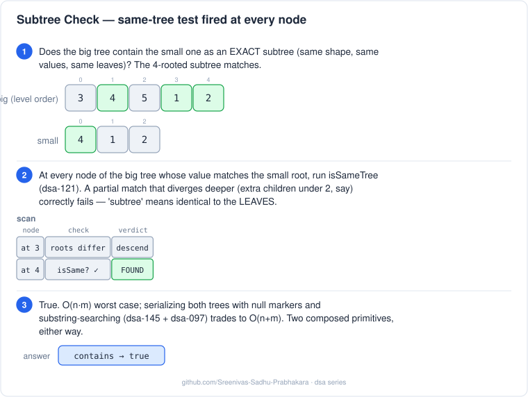

# Subtree of Another Tree

> NeetCode 150 · Trees · Blind 75 — try an exact-match at every node: identical-trees (the inner check) composed over a traversal (the outer walk). Go, stdlib only, tested.

## Problem

Does tree `sub` occur inside `root` as a *complete* subtree — matching all the way down to its leaves? A candidate that matches sub's shape but keeps growing below it does **not** count, which is the case naive prefix-matching gets wrong (pinned by a test).

## Approach

Two known pieces nested: the outer recursion visits every node of root; the inner one is dsa-121's identical-trees check, anchored at that node. "Complete subtree" falls out of identical's nil discipline — sub's nils must align with real nils in root, so extra children below the match kill it. Worst case is O(n·m) when many near-matches exist; the heavy-duty upgrade serializes both trees with null markers (dsa-145 style) and runs substring search (KMP, dsa-099) for O(n+m) — worth naming at the interview, overkill here.

**Complexity:** O(n·m) worst case, O(h) recursion.

## Visual walkthrough

Read the picture top to bottom — each numbered frame is one moment of the algorithm
running on this repo's test example.

## Run

    go test ./...   # verify
    go run .        # demo

---

Part of a 275-repo DSA series in Go — Striver's SDE Sheet (dsa-001–191) plus the NeetCode 150 / Blind 75 additions (dsa-192–275), stdlib only, every solution tested. Browse: [`dsa-*` repos](https://github.com/Sreenivas-Sadhu-Prabhakara?tab=repositories&q=dsa-&type=source).
